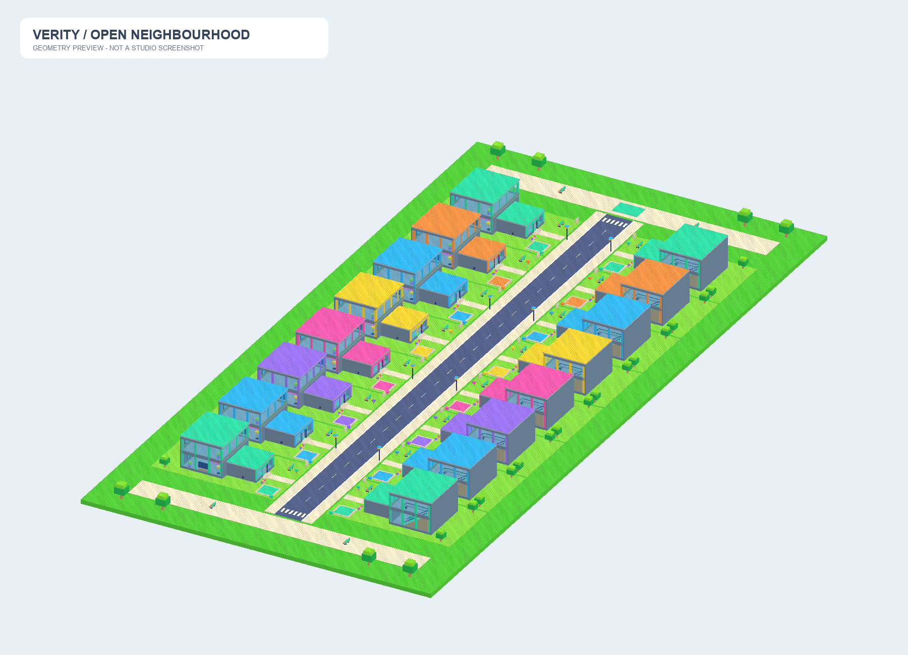
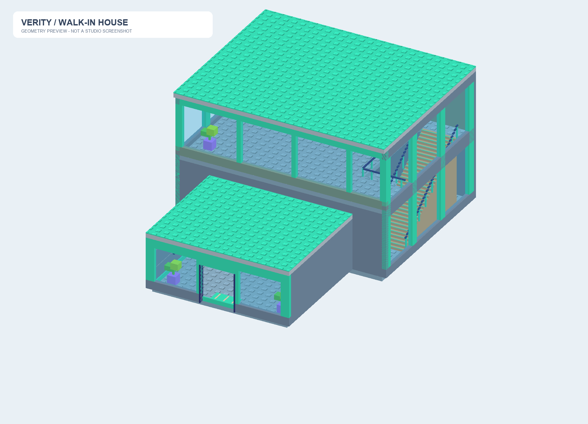

# Verity Growing Simulator — Open Neighbourhood v5

16 ярких двухэтажных домов с настоящими интерьерами прямо на участках. Вход с улицы пешком через открытый проём. Большие прозрачные окна позволяют видеть других игроков; частных комнат и телепортов нет.

## Открыть и посмотреть

Открыть `VerityNeighborhood.rbxlx` через File → Open from File в Roblox Studio, нажать Play. В карте уже есть все 16 домов, мебель, лестницы, участки и общий SpawnLocation. Это визуальная основа игры: серверная экономика, назначение владельцев и телефон ещё подключаются другими разработчиками.

В существующий проект можно вставить `VerityNeighborhood.rbxmx` через Insert from File. Не дублировать GeneratedWorld и не запускать генератор поверх импортированной карты. Новая версия требует увеличенных участков; старую карту v4 сначала сохранить отдельно и заменить целиком.

Для работы из исходников: `default.project.json` синхронизирует `src/world` и MapBootstrap. При запуске MapBootstrap вызывает `WorldBuilder.Build(workspace, 16)`, который создаёт уже меблированные дома. Скрытый шаблон ServerStorage больше не подключается.

## Что создано

- 16 участков 120 × 72 studs, по 8 с каждой стороны улицы; шаг рядов 72.
- Дома примерно 70 × 50 × 32.2 studs: входная комната, большая гостиная, лестница и просторный второй этаж.
- Реальные дверные проёмы, прозрачные окна с коллизиями, посещение соседей без перемещения в другую сцену.
- Голубой внутренний пол #86A9BF с мелкими Studs; спокойные стены, яркие фасадные акценты и крыши.
- Диван, телевизор, кухня, столы, книжная полка, торшер, растения, три стилизованных портрета Verity и декор во дворах. Наверху минимум мебели.
- Платформы Verity и маркеры для Core, без собственной экономики и назначения владельцев.

## Исходники и интеграция

`src/world/MapRecipe.luau` описывает район без повторения всех деталей домов; `InteriorRecipe.luau` — один общий рецепт. `WorldBuilder` размещает дома через `InteriorFactory.CreateHouse`. Все детали закреплены, каждый House использует Atomic streaming.

[Решение об открытых домах](docs/INTERIORS.md) · [Инструкция Core/UI](docs/INTERIOR_HANDOFF.md) · [Карта документации](docs/PROJECT_DOCUMENTATION.md).

[Основное ТЗ DOCX](docs/VERITY_GROWING_SIMULATOR_16_PLUS.docx) и [его текст](docs/PROJECT_SPEC.md); [промпты по зонам](docs/CODEX_PROMPTS.md). Уточнения пользователя в активных документах заменяют прежние решения. [Архивы карт v1–v4](releases/) и документы в `docs/archive` сохранены как история.

## Пересборка и проверки

`python tools/build_map.py` обновляет интерьер, полную XML-карту, рецепты и превью. Зависимости — `tools/requirements.txt`. Генератор не перезаписывает WorldBuilder, InteriorFactory, MapBootstrap или пользовательскую Rojo-конфигурацию. После изменения формы дома пересобирать весь мир.

`python tools/build_interior.py` обновляет только авторскую модель в `assets/interiors` и общий рецепт. `InteriorPreview.rbxlx` — отдельная сцена просмотра формы одного дома, а не работающая приватная комната.

Статически проверены границы 16 участков, отсутствие их пересечений, размещение всех деталей внутри участка, свободные входы, внутренние проходы, лестничный проём и верхняя площадка. Отчёты: `validation.json`, `assets/interiors/validation.json`. Rojo-сборка проверяется отдельно; программные изображения не являются скриншотами Studio.

В карте 7534 статичные детали и 80 локальных источников света без собственных теней. Это не замер производительности. Проверки движения персонажей, соседей, 16 игроков и мобильного FPS нужно завершить в Studio. Игровая логика, сохранения, UI и все стадии улучшений домов пока не реализованы.
